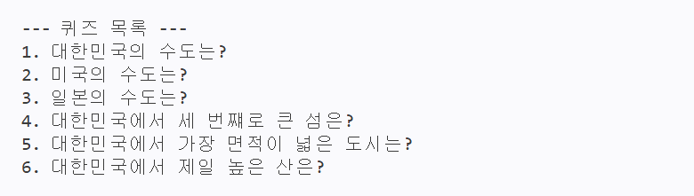
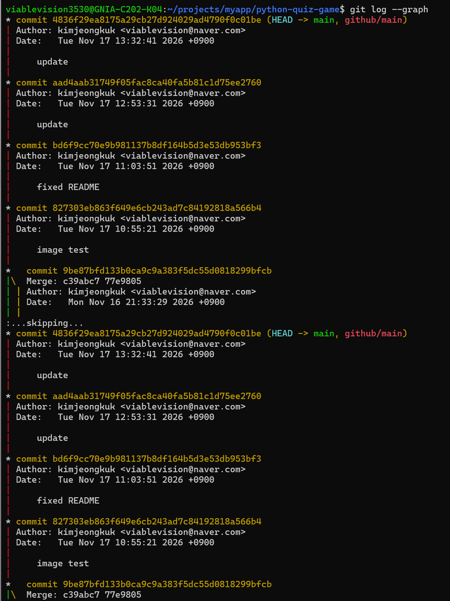
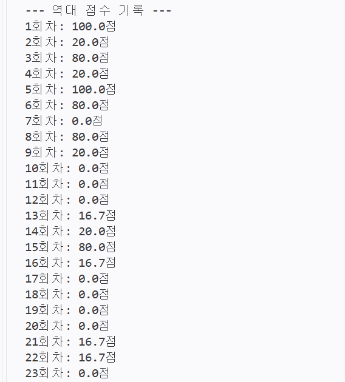
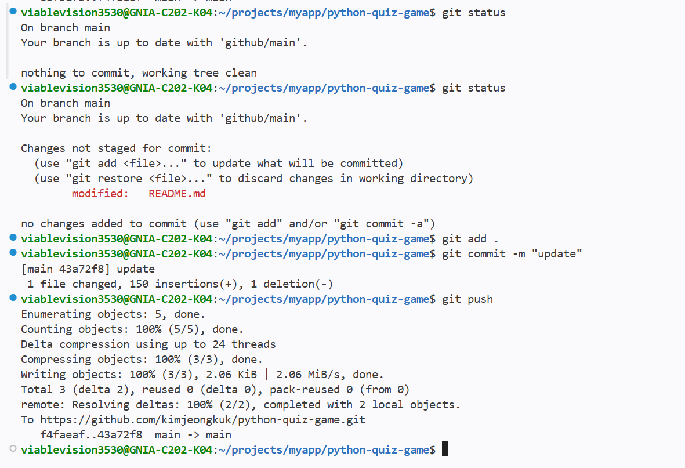
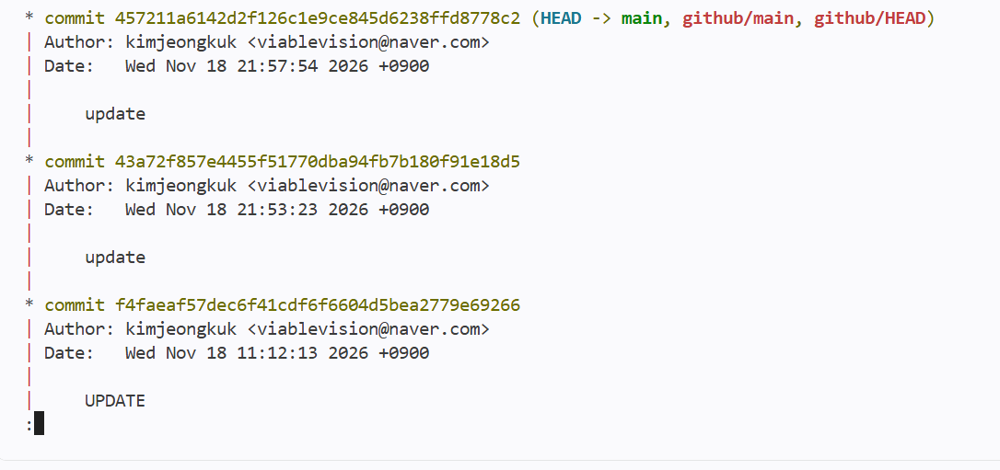
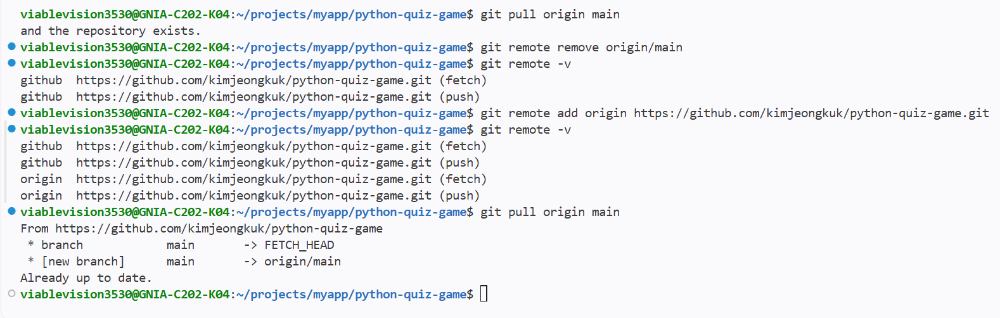
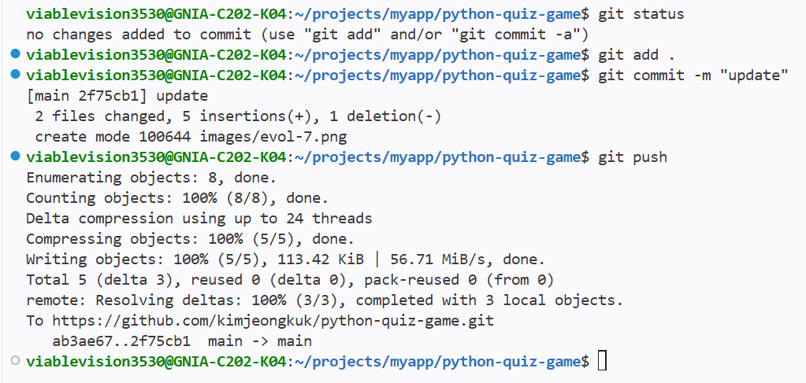
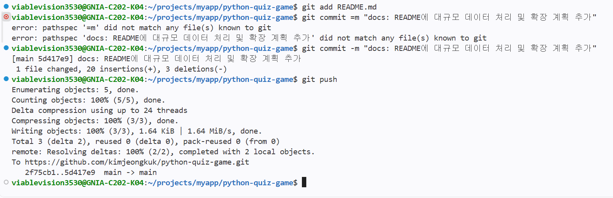

# 🐍 파이썬 연습_김정국
> 파이썬 기초 문법을 익히고 실습 과제를 해결하기 위한 학습용 저장소입니다.

## 1. 프로젝트 개요
하나의 콘솔 프로그램 안에서 다음을 통합 연습하는 것이 목표입니다.

파이썬 입문 문법 — f-string, 슬라이싱, match/case, 컴프리헨션 등
객체지향(OOP) — 2개 이상의 클래스, 역할 분리, 대체 생성자
파일 입출력 & 영속성 — JSON으로 상태를 저장해 재시작 후에도 데이터 유지
철저한 예외 처리 — 잘못된 입력·없는/손상된 파일·Ctrl+C 종료를 모두 우아하게 처리
Git 워크플로우 — 의미 있는 커밋, 브랜치 생성·병합, clone/pull
메뉴(풀기 / 추가 / 목록 / 점수 / 삭제 / 종료)를 반복 표시하며, 사용자가 만든 퀴즈와 플레이 기록은 state.json에 저장됩니다.

## 2. 프로젝트 소개
이 프로젝트는 파이썬(Python) 프로그래밍 언어의 핵심 개념을 학습하고, 다양한 미션을 통해 실전 코딩 능력을 기르기 위해 진행되었습니다.

## 3. 주요 학습 및 구현 내용
- **기초 문법**: 변수, 자료형, 조건문, 반복문 활용
- **함수 활용**: 재사용 가능한 코드 작성 및 매개변수 처리
- **데이터 처리**: 리스트, 딕셔너리 등 자료구조 활용 연습
- **카테고리 활용**: 난이도에 따라 카테고리에 맞는 문제 내기
- **[*5가지 간단한 상식 문제 퀴즈 맞추기*]**

## 4. 개발 환경
- **Language**: Python 3.x
- **IDE**: [*VS Code*]

## 5. 실행 방법
터미널 또는 커맨드 창에서 아래 명령어를 입력하여 실행할 수 있습니다.

```bash
# 파일 실행 예시
python3 [*main*].py
```

### 💡 마지막 체크리스트!   ###

1.  **2번 항목**: 이번에 가장 기억에 남는 코드는 '오답 노트 달기 입니다'.
      def show_wrong_answers(self):
        print("\n--- 오답 노트 ---")
        wrong_data = self.load_json(self.wrong_file)
        if not wrong_data:
            print("오답 노트가 비어 있습니다. 아주 훌륭해요! 🎉")
        else:
            for i, q in enumerate(wrong_data, 1):
                print(f"{i}. {q['question']}")
                # 오답 노트에서도 선택지 번호를 강제로 붙여서 보여줌
                for j, opt in enumerate(q['options'], 1):
                    print(f"   {j}. {opt}")
                print(f"   => 정답: {q['answer']}번")를 한 줄 적어주세요. (예: `리스트를 활용한 데이터 관리`)

2.  **3번 항목**: 사용했던 프로그램 이름은
          [*VS Code]

3.  **5번 항목**: 공부하면서 느꼈던 솔직한 기분은
          프로그램 로직에 대한 생각을 그대로 프로그램에 구현하는 과정 문법 등이 아직은 초보 수준입니다.

4. **실행 프로그램을 run하면 나오는 화면 캠처 내용:
  - 초기 화면:  
  


  - 1. 퀴즈 풀기:   
   2

  - 2. 퀴즈 추가:   
   

  - 3. 퀴즈 목록:   
   

  - 4. 퀴즈 기록:   
   

  - 5. 오답 노트:   
   

  - 6. 종료:   
   


   
## 종합 평가에 대한 보완(이유 설명 포함) ##

1. Git 증빙(log 파일 내용 주 일부 1/2):       
   - 

   Git 증빙(log 파일 내용 주 일부 2/2):       
   -  

   - 병합 완료된 브랜치: git branch --merged               결과: 'main'
   - 아직 병합되지 않은 브랜치: git branch --no-merged     결과: branch한 내용은 없음.
   - state.json: 퀴즈와 점수 데이터 저장 (파일 손상 시 복구 로직 포함)
                                                          결과: 본 프로그램에서는 사용되지 않았음.


## 평가 결과 보완 사항 ##

#1 실행(런타임) 증거(로그/스크린샷)가 제출되지 않았음     

-답변:
- 


평가 항목 #3
부족한 점
추가문항은 저장되나 '최고점'을 별도 보존·갱신하는 로직이 없음
보완
최고점 보존이 요구라면 최고점 계산 및 별도 저장 시점을 문서화하세요

- 답변:
- 


평가 항목 #5
부족한 점
원격 GitHub 업로드 및 최소 10회 의미있는 커밋 증빙이 제출되지 않음
보완
원격 저장소 URL과 커밋 로그(또는 GitHub 링크)를 README에 추가하세요

- 답변:
- 


평가 항목 #6
부족한 점
브랜치·병합 그래프(graph)와 병합 기록 증빙이 없음
보완
git log --graph 또는 GitHub의 PR/merge 캡처를 첨부하세요

- 답변: 
- 


평가 항목 #7
근거
README.md > './images/initial_screen.png'
잘한 점
프로그램 화면 스크린샷을 README에 참조함
부족한 점
clone/pull 실습(명령어 + 실행 스크린샷) 증빙이 없음
보완
git clone/pull 명령과 해당 터미널 스크린샷을 추가하세요

- 답변:
- 


평가 항목 #8
근거
main.py > 'class QuizSystem:'
잘한 점
클래스로 기능을 묶어 코드가 구조화되어 있음
부족한 점
Quiz 역할과 Game(전체) 역할을 문서로 분리·설명하지 않았음
보완
각 클래스의 책임(특히 Quiz vs Game)을 README에 명확히 기술하세요

- 답변: 실제 main.py에 현재 QuizSystem이 두 책임을 함께 담당하고 있습니다.
향후 Quiz 클래스와 Game 클래스로 책임을 분리하는 형태로 코딩을 하겠습니다.
(README.md에만 반영 하겠습니다.)


평가 항목 #9
근거
main.py > 'def load_json(self, filename):'
잘한 점
입력검증·게임진행·데이터입출력 관련 메서드로 분리되어 있음
부족한 점
분리 근거(설계 이유·흐름)를 문서로 제시하지 않음
보완
README에 각 로직(입력검증/진행/IO)의 책임과 인터페이스를 서술하세요

- 답변: 실제 코드에서 입력 검증이 별도 함수(def validate_...)로 분리되어 있지 않고 add_quiz와 main_menu 안에 들어 있습니다.

- 답변:
- 


평가 항목 #10
근거
main.py > 'self.quiz_file = \'quizzes.json\''
잘한 점
파일 기반 영속화 메커니즘이 구현되어 있음
부족한 점
요구서의 state.json 명칭과 실제 파일(quizzes.json/scores.json)이 다르며 로드/저장 시점·순서 설명이 없음
보완
state.json(또는 사용중인 파일)에 대한 로드·저장 시점과 순서를 README에 명시하세요

- 답변: 실제 코드는 "state.json 대신 quizzes.json / wrong_answers.json / scores.json으로 분리 운영 중" 입니다.


평가 항목 #11
근거
main.py > 'elif choice == \'6\':\n print("프로그램을 종료합니다.")'
잘한 점
메뉴 기반 정상 종료 경로가 존재함
부족한 점
시그널(SIGINT 등) 처리와 종료 시 데이터 동기화(강제종료 대비)가 구현/설명되어 있지 않음
보완
프로그램 종료(시그널) 처리 및 안전 저장 흐름을 구현하거나 문서화하세요

- 답변: 실제 코드는 현재 main.py의 구조(load_json, save_json, run_quiz, add_quiz, main_menu)를 크게 해치지 않으면서 SIGINT(Ctrl+C)를 잡거나 예외 발생 시 안전하게 종료·저장하도록 보완할 수 있습니다.
(README.md에만 반영 하겠습니다.)


평가 항목 #12
부족한 점
커밋 단위·메시지 규칙(템플릿/단위 규정) 문서가 없음
보완
커밋 템플릿과 권장 단위 규칙을 README에 추가하세요

-답변: 기존에 `git commit -m "update"`처럼 짧게 남겼던 이력을 단순 "update"` 대신 변경 대상과 목적을 드러내는 요약 문구를 추가해서 문서의 실효성을 높이겠습니다.
(README.md에만 반영 하겠습니다.)


평가 항목 #13
근거
main.py > 'class QuizSystem:'
잘한 점
클래스 사용으로 추상화 시도는 보임
부족한 점
클래스 사용 이유(추상화/재사용성 근거)를 설명하지 않음
보완
클래스 설계 이유와 재사용성을 README에 기술하세요

- 답변:
상기 #8(Quiz vs Game 책임 분리), #9(I/O·검증·진행 인터페이스) 섹션의 답변 내용 외에
1. 추상화 근거 (상태와 행위의 응집)
- 파일 경로와 상태의 한곳 관리를위해 인스턴스 상태로 묶어, 각 메서드가 전역 변수나 파일명을 일일이 인자로 넘기지 않고도 일관된 상태에 접근할 수 있으며,
- 세부 구현 숨김:, 호출부는 JSON 직렬화/역직렬화나 파일 존재 확인 같은 세부 구현을 직접 다루지 않고 `load_json`, `save_json` 및 기능 메서드를 통해 퀴즈 시스템의 동작 단위로 다룰 수 있습니다.
2. 재사용성 및 확장성 근거
- 다중 인스턴스 생성 가능성은 현재 `__init__`에서 기본 파일명(`quizzes.json`, `wrong_answers.json`, `scores.json`)을 설정하지만 생성자 매개변수로 확장하면 과목별·주제별 퀴즈 시스템 인스턴스를 독립된 데이터 파일로 여러 개 생성해 재사용할 수 있습니다.
- 테스트 및 기능 확장 용이성은 퀴즈 로직과 상태가 객체 단위로 캡슐화되어 있어, 향후 GUI/웹 인터페이스 연결, 오답 복습 전용 모드 추가, 또는 개별 메서드 단위 검증·리팩터링을 진행할 때 기존 흐름을 덜 깨뜨리고 확장할 수 있습니다.
(README.md에만 반영 하겠습니다.)


평가 항목 #14
근거
README.md > '데이터 처리: 리스트, 딕셔너리 등 자료구조 활용 연습'
잘한 점
데이터 구조 활용 의도가 README에 언급되어 있음
부족한 점
JSON 저장을 선택한 이유(가독성·구조화 등)를 명시적으로 설명하지 않음
보완
JSON 저장 선택 근거(가독성·확장성 등)를 README에 추가하세요

- 답변:
퀴즈 문항, 오답 노트, 점수 이력을 영구 저장하기 위해 단순 텍스트(`.txt`)나 CSV 대신 **JSON(`.json`) 포맷**을 선택한 이유는 다음과 같습니다.

1. **계층적 데이터 구조화 표현**
   - 퀴즈 한 문항은 질문(`question`), 4개의 선택지 리스트(`options`), 정답(`answer`)이 결합된 중첩 구조를 가집니다[cite: 1]. JSON은 리스트(`[]`)와 키-값 쌍(`{}`)을 그대로 표현할 수 있어 별도의 구분자 파싱 없이 복잡한 문항 데이터를 명확하게 구조화할 수 있습니다[cite: 1].
2. **파이썬 자료구조와의 높은 호환성**
   - 파이썬 표준 라이브러리(`json`)만으로 `list`와 `dict` 객체를 추가 변환 로직 없이 직렬화(`json.dump`)·역직렬화(`json.load`)할 수 있어 구현이 간결하고 데이터 손상 위험이 적습니다[cite: 1].
3. **사람이 읽기 쉬운 가독성과 디버깅 편의성**
   - `indent=4`와 `ensure_ascii=False` 옵션을 적용해 저장하므로[cite: 1], 개발자나 사용자가 에디터로 `quizzes.json`, `wrong_answers.json`, `scores.json` 파일을 직접 열어 한글 문항과 저장 상태를 한눈에 확인하고 검증하기 쉽습니다[cite: 1].
4. **스키마 확장성**
   - 추후 문항별로 난이도(`difficulty`), 카테고리(`category`), 해설(`explanation`) 같은 필드를 추가하더라도 기존 구조의 큰 변경 없이 키(key)만 확장하면 되므로 유지보수에 유리합니다.
(README.md에만 반영 하겠습니다.)


평가 항목 #15
근거
main.py > 'except Exception:\n return []'
잘한 점
파일 로드 시 예외를 잡아 기본값으로 처리하는 방어가 있음
부족한 점
파일/권한 오류별 세부 처리 및 복구 절차(백업/재시도)가 없음
보완
파일IO 오류 종류별 처리와 복구 절차를 설계·문서화하세요

- 답변:
파일 I/O 예외 처리 및 복구 절차 (Error Handling & Recovery)

현재 `load_json`은 예외 발생 시 빈 리스트(`[]`)를 반환해 프로그램의 비정상 종료를 방지합니다.
안정성과 데이터 보존을 높이기 위해 파일 입출력 오류 유형별 처리 기준과 복구 절차(백업·재시도)를 다음과 같이 설계합니다.
(README.md에만 반영 하겠습니다.)

1. 오류 유형별 처리 기준
 - `FileNotFoundError` (파일 미존재) | 최초 실행 또는 데이터 파일이 삭제된 경우 | 정상적인 초기 상태로 간주하고 빈 리스트(`[]`)로 초기화한 뒤, 다음 저장 시 새 파일을 생성합니다.
 - `json.JSONDecodeError` / `UnicodeDecodeError` (파일 손상·인코딩 오류) | 비정상 종료나 수동 편집으로 JSON 형식이 깨진 경우 | 손상된 파일을 덮어쓰지 않도록 백업 파일(`.bak`)로 격리 보존한 뒤, 기본값(`[]`)으로 복구하여 실행을 이어갑니다.
 - `PermissionError` (접근 권한 부족) | 파일이 읽기 전용이거나 다른 프로세스가 점유 중인 경우 | 사용자에게 권한·잠금 확인 안내 메시지를 출력하고, 저장 시에는 임시 경로 또는 재시도 절차를 수행합니다.
 - `OSError` / `IOError` (디스크 용량 부족·경로 오류 등) | 저장 매체 공간 부족이나 유효하지 않은 경로 접근 시 | 오류 원인을 터미널에 명확히 알리고, 일시적 오류에 대비해 제한된 횟수만큼 재시도한 뒤 실패 시 안전하게 안내합니다.
 (README.md에만 반영 하겠습니다.)

2. 데이터 복구 및 안전 저장 절차 (백업 · 재시도)
1) 손상 파일 백업 격리 (로드 시 복구)
   - `load_json` 실행 중 JSON 파싱 오류가 발생하면, 원본 파일을 `quizzes.json.bak` 형태로 백업해 데이터 유실을 막습니다.
   - 백업 완료 후 메모리 상태를 `[]`로 초기화하여 사용자가 프로그램을 계속 이용할 수 있게 합니다.
2) 임시 파일 기반 원자적 저장 및 백업 (`save_json`)
   - 기존 파일이 존재하면 저장 직전 `.bak` 백업본을 갱신하고, 임시 파일(`.tmp`)에 먼저 기록한 뒤 원본 파일로 교체해 쓰기 도중 중단되어도 기존 데이터가 깨지지 않도록 보호합니다.
3) 제한적 재시도 (Retry)
   - 파일 잠금(`PermissionError`)이나 일시적 `OSError` 발생 시 짧은 대기 후 최대 2~3회 재시도하며, 모두 실패하면 오류 메시지와 백업 파일 위치를 안내합니다.
(README.md에만 반영 하겠습니다.)


평가 항목 #16
근거
main.py > 'for i, quiz in enumerate(self.quizzes, 1):'
잘한 점
퀴즈를 리스트로 관리하는 단순한 구조로 구현되어 있음
부족한 점
1000개 이상 확장 시 성능·메모리·검색속도 한계 및 대응 방안이 문서화되지 않음
보완
대규모 데이터 처리 계획(인덱싱/DB전환 등)을 README에 기술하세요

- 답변:
향후에는 실제 main.py에서 wrong_data = [q for q in wrong_data if q['question'] != quiz['question']]처럼 리스트 전체를 훑으며 비교하는 부분과, save_json이 파일 전체를 덮어쓰는 부분을 짚어 주면 근거 코드(for i, quiz in enumerate(self.quizzes, 1): 등)와 자연스럽게 연결되도록 하겠습니다.
(README.md에만 반영 하겠습니다.)

작성 후 git add README.md → git commit -m "docs: README에 대규모 데이터 처리 및 확장 계획 추가" → git push 순서로 저장소에 반영 했습니다.

-       


평가 항목 #17
근거
wrong_notes.json > '"question": "미국의 수도는?"'
잘한 점
오답 노트와 유사한 파일이 제출되어 일부 데이터 보관 흔적이 있음
부족한 점
state.json 손상 시 백업·초기화·복구 절차(자동백업 등)가 정의되어 있지 않음
보완
자동 백업/버전 보존 및 복구 절차를 구현하고 문서화하세요

- 답변:
저장소에 이미 존재하는 오답 파일명(wrong_notes.json 또는 wrong_answers.json)과 main.py의 self.wrong_file 값이 다르면 한쪽으로 통일해 둠으로써 혼동을 줄이도록 하겠습니다.

backups/ 폴더를 만든 경우, 불필요한 백업 파일이 깃허브에 쌓이지 않도록 .gitignore에 backups/와 *.corrupt를 추가할지 여부도 함께 점검해 보겠습니다.

(README.md에만 반영 하겠습니다.)


평가 항목 #18
근거
main.py > 'final_score = (score / len(self.quizzes)) * 100'
잘한 점
점수 계산이 한곳(run_quiz)에서 수행되어 수정 지점이 명확함
부족한 점
요구 변경 시 수정 대상(점수계산 메서드·퀴즈 모델·저장소)에 대한 문서화가 부족함
보완
요구 변경 시 영향 범위(메서드/모델/저장소)를 README에 명확히 기술하세요

- 답변:
평가 근거에 언급된 'final_score = (score / len(self.quizzes)) * 100'가 run_quiz 한곳에 모여 있다는 장점을 살려, "점수 규칙 변경 시 run_quiz만 고치면 되지만, 문항별 배점·속성이나 저장 구조까지 바뀌면 모델과 JSON 파일까지 함께 수정해야 합니다.
(README.md에만 반영 하겠습니다.)