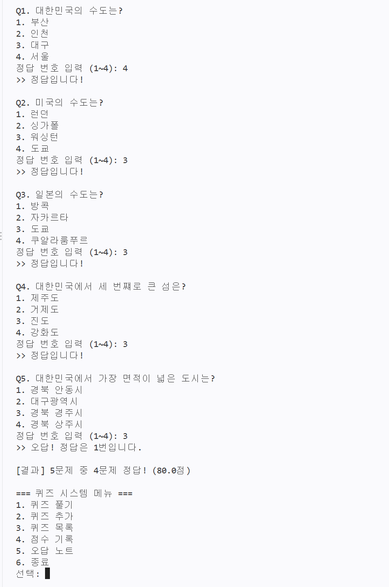
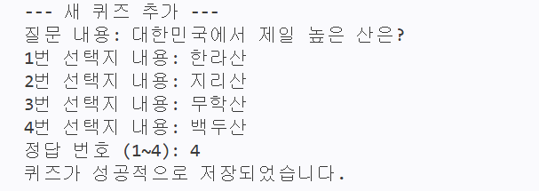
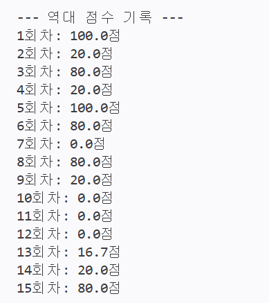
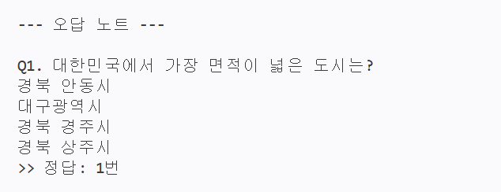
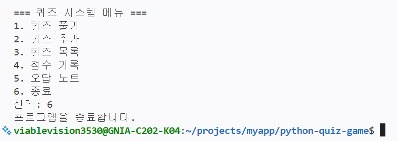
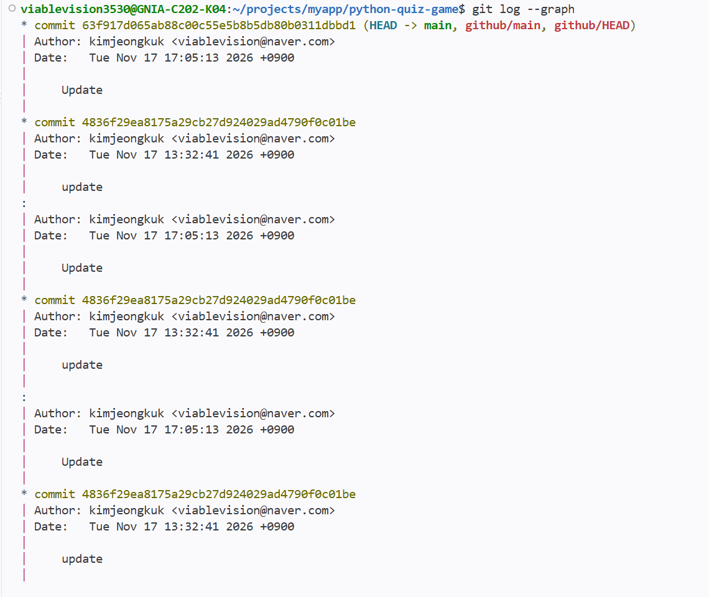
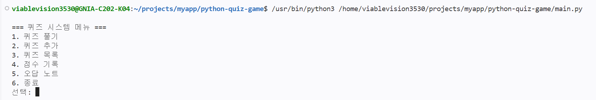

# 🐍 파이썬 연습_김정국
> 파이썬 기초 문법을 익히고 실습 과제를 해결하기 위한 학습용 저장소입니다.

## 1. 프로젝트 개요
하나의 콘솔 프로그램 안에서 다음을 통합 연습하는 것이 목표입니다.

파이썬 입문 문법 — f-string, 슬라이싱, match/case, 컴프리헨션 등
객체지향(OOP) — 2개 이상의 클래스, 역할 분리, 대체 생성자
파일 입출력 & 영속성 — JSON으로 상태를 저장해 재시작 후에도 데이터 유지
철저한 예외 처리 — 잘못된 입력·없는/손상된 파일·Ctrl+C 종료를 모두 우아하게 처리
Git 워크플로우 — 의미 있는 커밋, 브랜치 생성·병합, clone/pull
메뉴(풀기 / 추가 / 목록 / 점수 / 삭제 / 종료)를 반복 표시하며, 사용자가 만든 퀴즈와 플레이 기록은 state.json에 저장됩니다.

## 2. 프로젝트 소개
이 프로젝트는 파이썬(Python) 프로그래밍 언어의 핵심 개념을 학습하고, 다양한 미션을 통해 실전 코딩 능력을 기르기 위해 진행되었습니다.

## 3. 주요 학습 및 구현 내용
- **기초 문법**: 변수, 자료형, 조건문, 반복문 활용
- **함수 활용**: 재사용 가능한 코드 작성 및 매개변수 처리
- **데이터 처리**: 리스트, 딕셔너리 등 자료구조 활용 연습
- **카테고리 활용**: 난이도에 따라 카테고리에 맞는 문제 내기
- **[*5가지 간단한 상식 문제 퀴즈 맞추기*]**

## 4. 개발 환경
- **Language**: Python 3.x
- **IDE**: [*VS Code*]

## 5. 실행 방법
터미널 또는 커맨드 창에서 아래 명령어를 입력하여 실행할 수 있습니다.

```bash
# 파일 실행 예시
python3 [*main*].py
```

### 💡 마지막 체크리스트!   ###

1.  **2번 항목**: 이번에 가장 기억에 남는 코드는 '오답 노트 달기 입니다'.
      def show_wrong_answers(self):
        print("\n--- 오답 노트 ---")
        wrong_data = self.load_json(self.wrong_file)
        if not wrong_data:
            print("오답 노트가 비어 있습니다. 아주 훌륭해요! 🎉")
        else:
            for i, q in enumerate(wrong_data, 1):
                print(f"{i}. {q['question']}")
                # 오답 노트에서도 선택지 번호를 강제로 붙여서 보여줌
                for j, opt in enumerate(q['options'], 1):
                    print(f"   {j}. {opt}")
                print(f"   => 정답: {q['answer']}번")를 한 줄 적어주세요. (예: `리스트를 활용한 데이터 관리`)

2.  **3번 항목**: 사용했던 프로그램 이름은
          [*VS Code]

3.  **5번 항목**: 공부하면서 느꼈던 솔직한 기분은
          프로그램 로직에 대한 생각을 그대로 프로그램에 구현하는 과정 문법 등이 아직은 초보 수준입니다.

4. **실행 프로그램을 run하면 나오는 화면 캠처 내용:
  - 초기 화면:  
  


  - 1. 퀴즈 풀기:   
   2

  - 2. 퀴즈 추가:   
   

  - 3. 퀴즈 목록:   
   

  - 4. 퀴즈 기록:   
   

  - 5. 오답 노트:   
   

  - 6. 종료:   
   


   
## 종합 평가에 대한 보완(이유 설명 포함) ##

1. Git 증빙(log 파일 내용 주 일부 1/2):       
   - 

   Git 증빙(log 파일 내용 주 일부 2/2):       
   -  

   - 병합 완료된 브랜치: git branch --merged               결과: 'main'
   - 아직 병합되지 않은 브랜치: git branch --no-merged     결과: branch한 내용은 없음.
   - state.json: 퀴즈와 점수 데이터 저장 (파일 손상 시 복구 로직 포함)
                                                          결과: 본 프로그램에서는 사용되지 않았음.


## 평가 결과 보완 사항 ##

#1 실행(런타임) 증거(로그/스크린샷)가 제출되지 않았음     
- 


#5 원격 GitHub 업로드 및 최소 10회 의미있는 커밋 증빙이 제출되지 않음


