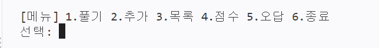

# 🐍 파이썬 연습_김정국
> 파이썬 기초 문법을 익히고 실습 과제를 해결하기 위한 학습용 저장소입니다.

## 1. 프로젝트 소개
이 프로젝트는 파이썬(Python) 프로그래밍 언어의 핵심 개념을 학습하고, 다양한 미션을 통해 실전 코딩 능력을 기르기 위해 진행되었습니다.

## 2. 주요 학습 및 구현 내용
- **기초 문법**: 변수, 자료형, 조건문, 반복문 활용
- **함수 활용**: 재사용 가능한 코드 작성 및 매개변수 처리
- **데이터 처리**: 리스트, 딕셔너리 등 자료구조 활용 연습
- **카테고리 활용**: 난이도에 따라 카테고리에 맞는 문제 내기
- **[*5가지 간단한 상식 문제 퀴즈 맞추기*]**

## 3. 개발 환경
- **Language**: Python 3.x
- **IDE**: [*VS Code*]

## 4. 실행 방법
터미널 또는 커맨드 창에서 아래 명령어를 입력하여 실행할 수 있습니다.

```bash
# 파일 실행 예시
python3 [*main*].py

### 💡 마지막 체크리스트!

1.  **2번 항목**: 이번에 가장 기억에 남는 코드는 '오답 노트 달기 입니다'.
      def show_wrong_answers(self):
        print("\n--- 오답 노트 ---")
        wrong_data = self.load_json(self.wrong_file)
        if not wrong_data:
            print("오답 노트가 비어 있습니다. 아주 훌륭해요! 🎉")
        else:
            for i, q in enumerate(wrong_data, 1):
                print(f"{i}. {q['question']}")
                # 오답 노트에서도 선택지 번호를 강제로 붙여서 보여줌
                for j, opt in enumerate(q['options'], 1):
                    print(f"   {j}. {opt}")
                print(f"   => 정답: {q['answer']}번")를 한 줄 적어주세요. (예: `리스트를 활용한 데이터 관리`)

2.  **3번 항목**: 사용했던 프로그램 이름은
          [*VS Code]

3.  **5번 항목**: 공부하면서 느꼈던 솔직한 기분은
          프로그램 로직에 대한 생각을 그대로 프로그램에 구현하는 과정 문법 등이 아직은 초보 수준입니다.

4. **실행 프로그램을 run하면 나오는 화면 캠처 내용:
  - 초기 화면
  


